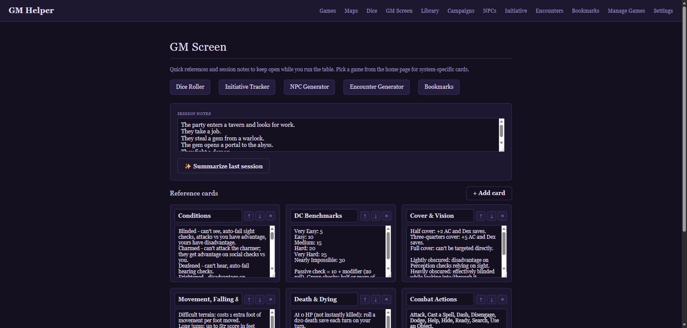

# GM Helper



A small self-hosted app for running tabletop RPG sessions: pick a game, search
your own PDF library full-text, open any book straight in your browser's PDF
viewer (search results jump right to the matching page), bookmark pages into
your own named collections with notes for session prep, flesh out a full
**Campaign Planner** for each game, generate dungeons, buildings, cities,
caves, and wilderness/world maps on the **Maps** tab, and use a dice roller,
NPC generator, initiative tracker, and encounter/loot generator while you
play - plus a **GM Screen** with per-system quick-reference cards, **random
tables** you can roll (and chain together), and a **player view** for maps with
fog of war and **tokens** you can drag around while the players watch. Point it at a local or hosted LLM in Settings and it also picks up a
handful of AI-assisted tools - "Ask the Library" questions with page citations,
campaign recaps and prep suggestions, session recaps, NPC dialogue, and
one-shot adventure generation - see **AI features** below. The auto-detected
Series-to-game grouping is just a starting guess - use
**Manage Games** in the nav to rename a game, merge one game entirely into
another, or move a single Series folder to a different game, all without
touching `games.json` by hand. When a whole Series is itself a mix (a
reference line or magazine that spans systems), the Library page lets you
check individual books and move just those to a different game - that
choice sticks even if the file changes on a later scan, and can be reset
back to automatic per book.

Older scanned PDFs with no embedded text layer can be made searchable via
OCR (Settings page) - see the OCR section below before running it on a
whole library.

## Running it on your PC (v1)

On Windows (Command Prompt or PowerShell), from the project folder:

```bat
cd C:\path\to\GM_Helper_App
py -m pip install -r requirements.txt
py run.py
```

On macOS/Linux use `python3` in place of `py`. Then open http://localhost:8000
in a browser.

`requirements.txt` is the core app only. OCR for scanned books is optional and
pulls in PyTorch (a very large download), so it has its own file - run
`py -m pip install -r requirements-ocr.txt` only if you want it. Without it
everything else works and the Settings page tells you OCR isn't installed.

On first run, go to **Settings** and enter the path to your library's root
folder - the folder that contains your `Publisher/Series/...` book folders
(the same one you'd point Chaptarr, Calibre, etc. at). Click **Scan library**
to find your books, then **Index new/changed books** to make them full-text
searchable. Indexing reads every PDF's text, so it can take a while the first
time on a large library - subsequent scans only re-index books that changed.

Older scanned PDFs with no embedded text layer will show up as "not
searchable" in the Library view rather than silently returning no search
results - see **OCR for scanned books** below to make them searchable.

Until a library folder is set, scanned and indexed, the home page shows a
short "start here" card pointing at the next step.

## Finding your way around

- **Home** lists your games and, once you have some work in progress, a
  **Pick up where you left off** strip: the campaigns you touched last (with
  how much of their next session is prepped), your latest maps and your latest
  bookmarks, across every game, one click each.
- **Quick jump** (the **Jump to...** button in the header, or **Ctrl+K** /
  **Cmd+K** anywhere) searches your own stuff by name: campaigns, NPCs,
  locations, factions, plot threads, sessions, maps, random tables, bookmarks
  and every page of the app. Arrow keys and Enter pick a result, Escape closes
  it, and results from the game you're in rank first. An empty box shows what
  you worked on last. The last row always runs the same words as a Library
  search. Jumping to an NPC, session and so on lands on that item and opens it.
- The header menu groups the pages (**Games**, **Library**, **Campaigns**,
  **Maps**, **GM Screen**, **Tools**, **More**), the game switcher keeps you in
  the game you picked, and the current page is marked. On a phone the menu
  folds behind the **Menu** button.
- Changed CSS and JavaScript files carry a version in their URL, so after you
  update the app a normal page load picks up the new look - no hard refresh.

## Which folders map to which "game"?

Edit `app/data/games.json`. Each game lists the Series-level folder names
(the folder directly under a Publisher folder) that belong to it, plus a
`system` hint (`"d20"`, `"palladium"`, `"savage_worlds"`, or `"generic"`)
that flavors the NPC generator's names and roles. The shipped file matches
this library's exact folder names as a starting point - nothing else in the
app hardcodes folder names, so you can freely re-map series to games, rename
games, or add new ones. Any book whose Series folder isn't listed anywhere
falls into "Unsorted / Other".

## Data storage

Everything the app tracks (your library folder setting, the book index,
campaigns and their cast, maps, bookmarks, GM Screen cards and notes, random
tables, initiative-tracker state) lives in a single SQLite file,
`gm_helper.db`, created next to `run.py`. Nothing is written into your
library folder itself - it's only ever read from. NPCs you roll on the NPC
Generator aren't stored on their own; send one to a campaign's Cast to keep it.

### Backups

**Settings -> Backup** has two downloads, both consistent snapshots that are
safe to take while the app is running:

- **My data** - everything you created, minus the book search index and your
  saved AI key. Usually well under a few MB.
- **Full copy** - the database exactly as it is on disk. Can be hundreds of MB
  because of the search index, and it **includes your saved AI API key**, so
  keep it private.

**Automatic backups** are on by default. About a minute after the app starts, and
then every ten minutes, it checks whether the newest one is older than your
chosen interval (a day unless you change it) and, if so, saves a small "my data"
copy into a `backups` folder next to the database (set `GM_HELPER_BACKUP_DIR` to
put it elsewhere). It keeps the newest 14 and deletes older ones. Change the
interval, the number kept, or switch it off under **Settings -> Backup**, where
you can also **Back up now** and download any of them. This protects you from
mistakes, a bad update and a damaged database. **It does not protect you from
the disk failing**, because the copies live on the same disk, so now and then
copy the `backups` folder somewhere else.

To restore on Windows: stop GM Helper, rename the current `gm_helper.db` (for
example to `gm_helper.db.old`), delete `gm_helper.db-wal` and `gm_helper.db-shm`
if they exist, copy your backup in and name it `gm_helper.db`, then start the
app. After restoring a "My data" backup, click **Index new/changed books** on
the Settings page to bring Library search back. Your PDFs are never part of a
backup - they stay where they are.

### Optional password

By default there's no login (it's meant for your own machine or home network).
To require one, set the `GM_HELPER_PASSWORD` environment variable before
starting the app; every page, API call and static file then asks for a login
(HTTP Basic). The username is `gm` unless you set `GM_HELPER_USER`.
`/healthz` stays open so Docker's health check keeps working. In PowerShell:

```powershell
$env:GM_HELPER_PASSWORD = "pick-something-long"
py run.py
```

Basic auth sends the password with every request, so use it on a trusted
network or behind HTTPS (for example a reverse proxy) - it keeps casual
visitors on your LAN out, it isn't a substitute for HTTPS on the open internet.

Want separate sign-ins for you and your players instead? See **Accounts: GM and
players** below; this shared password is then no longer used.

## Accounts: GM and players

Accounts are **off until you create the first one**, so nothing changes for a
solo GM. When you want players to sign in:

1. Open **More -> Users**, choose a username and password, and click **Create GM
   account and turn on accounts**. You're signed in straight away.
2. On the same page, **Add someone**. Leave the password blank and GM Helper makes
   a temporary one (like `9ztr-cpy6-xss9`) and shows it **once** - pass it on. The
   player is made to choose their own password the first time they sign in.
3. On a campaign's page, use the **Players** card to add them to that campaign.
   Only players in a campaign can see it.
4. On a map, give a token to a player (the **Player** drop-down next to each token)
   so they can drag it.

What a **player** can do - and nothing else:

- see the campaigns they were added to: the premise and tone, **what the party has
  learned** (secrets you've marked as revealed), the summaries of sessions you've
  marked *played*, and the maps attached to the campaign;
- open the **live map** of those campaigns, which updates as you reveal it, and drag
  **their own token** (only the ones you gave them, never a hidden one);
- keep **private notes** per campaign. You can read them on the campaign page;
  other players can't;
- read a game's **library** only if you tick **Library** for that player and game
  (Users -> Games & library). It is off by default, because it is your copy of the
  books - check your licences first. Adding a player to a campaign switches that
  game on for them but never the library.

A **GM** account sees everything and can open the player pages too (as a preview).
Players who try a GM page are sent back to their own page, and the same goes for the
data behind it: every route is classified GM-only unless it is on a short list that
`tests/test_access.py` pins down, so a new page you add later is closed to players
until you decide otherwise.

**What the player pages never contain:** NPC secrets, locations, plot threads,
factions, clocks, unrevealed secrets, sessions you haven't played, session prep, your
AI settings, backups, or other players' notes and tokens.

**Staying safe on the internet.** Passwords are stored with scrypt, sessions are
random server-side tokens (14 days, extended while in use; ended by Sign out, by
disabling the account, and - on your other devices - by changing the password), the cookie is HttpOnly and
SameSite, and requests from another website are refused. Wrong passwords are
throttled: five wrong tries for one name from one address, or ten from one address,
lock sign-in for 15 minutes (the counters are in memory and reset on restart). If you
publish GM Helper outside your home network, put it behind an HTTPS reverse proxy
(Nginx Proxy Manager, Caddy, a Cloudflare Tunnel...) and tell it so with these
environment variables (in your `.env` for Docker):

| Variable | Set it to | Why |
|---|---|---|
| `GM_HELPER_TRUST_PROXY` | `1` | Use the address the proxy forwards (`X-Forwarded-For`) for the sign-in limits. **Without it, everyone arriving through the proxy looks like one address, so a single attacker can lock all of you out.** Only set it when the proxy is the only way in, because anyone who can reach the app directly can forge that header. |
| `GM_HELPER_SECURE_COOKIES` | `1` | Always mark the cookie Secure. (It is also done automatically when the proxy sends `X-Forwarded-Proto: https`.) |
| `GM_HELPER_TRUSTED_ORIGINS` | `https://gm.example.com` | Only needed if your proxy doesn't pass the original `Host` header on; lists the public address(es) that may post forms. Comma-separated. |

Plain HTTP on your home network works with none of these set. Don't expose the app
to the internet over plain HTTP: passwords and sessions would cross it unprotected.

**Locked out?** The command line can always get you back in. In Docker (swap
`gm-helper` for your container's name - `docker ps` shows it):

```powershell
docker exec -it gm-helper python -m app.accounts list
docker exec -it gm-helper python -m app.accounts reset-password zak
docker exec -it gm-helper python -m app.accounts create-gm newname
```

(Running it directly on your PC: `py -m app.accounts list`, and so on, from the
project folder.) `reset-password` prints a temporary password and makes the account
choose a new one at its next sign-in.

**Backups and accounts.** Backups keep the accounts (so a restore doesn't lose your
players) but never the live sign-in sessions, so after restoring everyone signs in
again.

**Honest limits of this version:**

- There is **one kind of GM**; there's no co-GM who can run just one campaign.
- No e-mail, "forgot password" link or single sign-on: you reset passwords for
  people yourself.
- A player's token is a token on the map, not a character sheet; there are no
  player-owned characters, and NPCs and locations can't be shared with players
  (yet).
- The player map is the same picture the GM sees, with the secret-door markers and
  hidden tokens removed. **Fog of war is cosmetic**: a player who knows how to look
  at the page source can see the unrevealed parts of the map. That is fine for a
  table of friends but not a way to keep a map truly secret.
- The shared `GM_HELPER_PASSWORD` stops being used once the first account exists.

## Running in Docker (planned deployment path)

```bash
docker build -t gm-helper .
docker run -p 8000:8000 \
  -v /path/to/your/library:/library:ro \
  -v gm-helper-data:/data \
  gm-helper
```

Then set your library folder in Settings to `/library` (the path *inside*
the container). The SQLite DB persists in the `gm-helper-data` volume so it
survives container restarts/rebuilds.

Two image variants are published to `ghcr.io/kazwahs/gm-helper`:

| Variant | Tags | What it has |
| --- | --- | --- |
| full | `latest`, `1.2.3`, `sha-<commit>` | Everything, including EasyOCR/PyTorch for OCR |
| slim | `latest-slim`, `1.2.3-slim`, `sha-<commit>-slim` | No OCR libraries - far smaller |

To build the slim image yourself: `docker build --build-arg INSTALL_OCR=false -t gm-helper:slim .`
The image build, and the GitHub Actions run before it, start with a **startup
check**: every file must compile on the image's Python version (3.11) and the app
must import. A typo that only breaks on 3.11 now stops the build with a clear
error instead of producing an image that crashes when it starts. The container has a health check that calls `/healthz` (it checks the database
too), so `docker ps` shows `healthy` / `unhealthy`. Set `GM_HELPER_PASSWORD` in
your `.env` to turn the password on (see above).

**A note on OCR and GPUs under Docker:** EasyOCR's GPU acceleration is
CUDA-only - it has no support for Intel Arc (or any non-NVIDIA) GPU, so if
your Docker host doesn't have an NVIDIA card, OCR will run CPU-only inside
the container regardless of what video hardware is actually in the box.
The fix isn't to fight that - just run OCR on a machine with an NVIDIA GPU
first (e.g. via `python run.py` directly, as described above), then copy
the resulting `gm_helper.db` into the `gm-helper-data` volume on the Docker
host. OCR'd text lives in the database, not in the PDFs, so it carries over
with the DB file and never needs to be redone in the container.

## Campaign Planner

Each game gets its own **Campaigns** tab for fleshing out and running a
campaign, laid out the way most GM prep and campaign-wiki tools converge on:

- **Overview** - the premise/pitch, tone and themes, and a status (planning,
  active, paused, completed).
- **Plot threads** - open story threads with real stakes, tracked from seed
  through active to resolved (or dropped) instead of getting lost in notes.
- **Cast** - NPCs with a role, a disposition toward the party, what they
  want, and what they're hiding - a name alone is just set dressing. Roll
  one up on the NPC Generator page and there's a one-click "Add to
  campaign's cast" to send it straight into a campaign's Cast list.
- **Factions** - the powers pursuing their own goals while the party's
  doing something else, each with a **standing** toward the party (hostile,
  unfriendly, neutral, friendly or allied).
- **Ties** - who is allied with, owes, fears or is related to whom, between
  your factions and your cast ("Marlowe fears The Guild"). Removing an NPC or a
  faction removes its ties.
- **Clocks** - a threat on a timer ("the ritual completes", 3 of 6). Click a
  segment, or use + and minus, as the world moves; a full clock tells you it is
  time for the thing to happen. A clock can belong to a faction and carries a
  note on what happens when it fills.
- **Secrets & clues** - what the party could discover, each with where they can
  learn it and the session it was prepped for. **Import from session prep**
  turns the Secrets & clues box of each session into entries, one per line,
  skipping any already listed. When the party learns one, press **Reveal**: it
  is marked revealed and a *clue* line goes into the session log (of the session
  you have selected in the log below, so the recap sees it). **Hide again** takes
  it back. This list is GM-only.
- **Locations** - the map, nested under each other so you can always answer
  "where is this" by looking one level up.
- **Sessions** - prep the next one (a strong opening, potential scenes,
  secrets/clues to seed, anything else prepped) and, after the fact, log
  what actually happened - so the next prep session builds on real events
  instead of guesswork.
- **Session log** - a quick running log while you play. Pick a session (it
  defaults to the one in progress), choose a kind - **note, scene, combat,
  loot, clue** or **roll** - type a line and press Enter. Entries can be
  edited, re-typed or deleted, and each session shows how many entries it has.
  The Dice Roller and Random Tables pages have an **Add to session log**
  button that drops a roll straight into the log of the game's most recently
  active campaign that isn't completed (in its current session). When you ask
  the AI for a **recap**, sessions with no written summary are recapped from
  their log instead, and **Summarize** (on a session's log) turns one session's
  log into a short summary you can add to that session. The Markdown export
  includes the log in the GM copy only.
- **Materials** - the books and pages you'll need to run it. This reuses
  the Bookmarks system rather than a second one: every campaign gets its
  own bookmark collection automatically, so anything you add here also
  shows up on the Bookmarks page (and vice versa - a bookmark saved from a
  Library search can go straight into a campaign's collection).

Every field auto-saves as you edit it - there's no separate "save" step to
remember. Deleting a campaign removes its threads, cast, factions,
locations, sessions, and its materials collection along with it.

Things in a campaign link to each other: an NPC can belong to one of the
campaign's **factions** and live at one of its **locations**, and a location
can be linked to one of your saved **maps** (with an "Open map" shortcut). A
map belongs to one campaign's location at a time - linking it somewhere else
moves it. **Export** (campaign page) downloads the whole campaign as a Markdown
file, with a "player-safe" version that leaves out the GM-only parts (secrets,
hidden motives, unrevealed threads, faction standing, ties and clocks) so you
can hand it to your players. The player-safe version only shows a secret once
you have revealed it, under "What the party has learned".

## Maps

The **Maps** tab procedurally generates six kinds of map as scalable SVG - no
image files, no external art, nothing downloaded - and renders in well under a
second. Pick a **Style**:

- **Ink (hand-drawn)** is the default. It borrows the look of Campaign
  Cartographer / Dungeondraft style maps: pen-drawn walls with a soft inner
  shadow, hatched rock around the edges, a faint floor grid, hand-wobbled
  lines and a paper grain.
- **Classic (flat colour)** is the original look, kept for anyone who prefers
  it. Maps you saved before the Ink style existed keep their original look.

The six kinds of map:

- **Dungeon** and **Building Interior** - rooms of different shapes (square,
  round, octagonal, cross-shaped) joined by straight corridors and doors, laid
  out one of three ways: a **warren** that grows like a tree and then adds
  loops, a **keep** on a grid of chambers, or a **hub** around a central
  rotunda. Every map is checked to be fully connected. Doors come in several
  kinds (plain, arch, swing, locked and **secret**), some rooms have stairs, and
  each room is numbered and most are named, with furniture drawn on top. Secret
  doors look like wall to everyone but carry a small **S** marker for you -
  the marker is hidden on the player view and left off the printout unless you
  tick **Mark secret doors (GM copy)**.
- **City / Urban** - real streets and individual building footprints (some
  L-shaped, some left as yards). Three plans: **organic** (wide avenues with
  narrower lanes off them, gently bent), **grid**, and **radial** (ring roads
  and spokes around a central plaza). Blocks carry a faint district tint, and
  a few become parks, a market plaza or a named **landmark**. Fantasy cities
  are sometimes walled, with gates and towers. The legend sits in its own
  strip beside the map instead of covering part of it.
- **Underground / Caves** - a cellular-automata cave smoothed into one flowing
  outline, with hatched rock, stipple and a few feature markers (an underground
  lake, an exposed power conduit, whatever the setting calls for). Disconnected
  pockets get tunnelled into the main cavern so it's always reachable.
- **Wilderness** and **World** - landmasses from smooth noise (a continent,
  an archipelago, a peninsula or an inland sea) with soft coastlines, biomes
  driven by height, moisture and temperature, mountain / hill / tree symbols,
  rivers that run downhill to the sea (or end in a lake), roads joining the
  settlements, and named towns and points of interest. Tick **Hex grid** to
  draw a hex overlay for hex crawls. Both come with a legend strip, a scale
  bar and a compass rose.

**Setting** (High Fantasy / Modern / High Technology / Mixed) is independent
of map type - a high-tech dungeon (a facility with a reactor chamber and
security checkpoints) and a fantasy building interior (a manor with a
crypt in the basement) are both fair game. Mixed draws its vocabulary from
all three settings at once, for a genuine mashup. Every map is
reproducible from its seed, though the UI's "Reroll" just asks for a fresh
one rather than tweaking an existing map by hand - regenerate until you
like it, then save.

A saved map can optionally be attached to a campaign (shows up in that
campaign's own Maps section) the same way a material can, though maps
aren't deleted if their campaign is later deleted - only detached. Every
map can be downloaded as SVG (scales to any size, editable in Inkscape/etc.)
or PNG straight from the browser.

### Player view, fog of war and printing

Each saved map has three extra ways to put it in front of players:

- **Player view** opens a clean full-screen page (no GM controls) you can put
  on a second monitor or TV. With **fog of war** switched on, the map starts
  covered; on the GM's page you reveal **circles** or **rooms** by clicking,
  with **Undo** and **Clear**, and the player page updates by itself within a
  couple of seconds.
- **Print** lays the map out on paper: choose paper size, orientation, margins
  and how many inches each grid square should be. A map bigger than one sheet
  is split into tiles you tape together, and an optional grid overlay helps
  when the generator's own grid is faint. For dungeon, interior, urban and
  underground maps the generator's square size is known, so the scale is
  exact; for other map types it's an estimate. Secret-door markers are left
  off unless you tick **Mark secret doors (GM copy)**, and Ink maps print
  without their wobble and shadow effects unless you tick **Pen & paper
  effects** (see Limitations).
- **Tokens** are markers for the party and the foes. On the GM's page add one
  (name, colour, size), click **Place on map...**, then click the map. Drag a
  token to move it; the player view follows within a couple of seconds. Tokens
  can be renamed, recoloured, resized and marked **Hidden** - a hidden token
  shows dashed on your screen and is never sent to the player view, so you can
  set up an ambush. The fog layer stays on top of the tokens, and tokens are
  left out of the saved/downloaded map and the print page. **Tokens and the
  initiative tracker:** *Add everyone from the initiative tracker* makes a token
  for each combatant on the game's board (foes start hidden unless you untick
  that), and a token can be linked to a combatant by hand. A gold ring marks
  whose turn it is, **Next turn** advances the tracker from the map page, and a
  token whose combatant has dropped to zero hit points shows a red cross. The
  player view gets only the ring and the cross - never hit points, conditions or
  the combatant's name - and hidden tokens still never leave the GM's page.
  Tokens whose combatant left the tracker can be cleaned up in one click.
- **Handouts** are a letter, a rumour or a picture you can put on the player
  view. Create them on the map page (text, or an image upload: PNG, JPEG, GIF
  or WebP up to 4 MB), then **Show to players** - it opens as a full-screen
  overlay on the player view, players can close it on their own screen, and
  **Hide** takes it away for everyone. Editing a shown handout shows it again.
  Handouts belong to the game, so any of its maps can show them.
- Fog is a **visual cover only**. It hides the map on screen, but the full map
  is still in the page's source, so a player who knows how to "View Source"
  could see it. Use it at the table, not as a secret-keeper.

### Room keys

Dungeon and Building Interior maps have a **Room key** card: **Generate key**
writes an entry for every numbered room (what the players see, what is hiding
there, any secret or locked doors, which rooms it connects to) in plain words,
not game statistics, so it works for any game. Each room's entry is editable;
**Creatures from** lets you pull the creatures from one of your own random tables
instead of the built-in list; with an AI model connected, each entry also has a
button to flesh it out. Click a room on the map and its entry opens. **Print the
key** gives a clean page to keep beside the map. The key is stored
alongside the map, separate from its drawing.

### Linked maps

A map can point to other maps: a settlement on a world map to its own city map,
a city to a building, a dungeon level to the one below (and back up). The
**Linked maps** card lists what this map connects to. Each settlement it finds
on a world map gets a **Make its map** button that draws a city in the same game,
campaign and style and links the two (the row turns into **Open its map**).
Dungeons, interiors and caves get **Add a level below** and **Add a level above**
(it notes which rooms have stairs), a city gets **Add a building interior**, and
**Link an existing map** joins two maps you already have. Clicking a settlement
on the map jumps to its row in the card. Unlinking never deletes either map.

### Exporting to a virtual tabletop

The **Export to a virtual tabletop** card (dungeon, interior, caves and city
maps) downloads a Universal VTT file (`.dd2vtt`): the map image drawn to the grid
you choose (pixels per square) plus walls and doors for dynamic lighting. Walls
and doors are worked out from the map's saved seed, so they only exist for Ink
dungeons, interiors and caves; everything else (cities, Classic-style maps, or a
map whose drawing no longer matches what its seed produces) is exported as the
image on the right grid with no walls, and the card says so.
Secret doors become plain wall, and locked doors export as closed doors.

> **Not tested against a real tabletop.** The file follows the published
> Universal VTT format and its walls were checked by drawing them over the map,
> but it has not been imported into Foundry VTT, Roll20, Fantasy Grounds or
> anything else. Import one map and check the walls and doors before relying on it.

### Editing a saved map

Every saved map's page has an **Edit map** button. Turn it on and every
generated room, block, settlement, object and cave feature marker becomes an
element you can click to select:

- **Drag** a selected element anywhere on the map.
- **Relabel** it by typing in the side panel's label field (a room name that
  wraps onto two lines has a box for each line).
- **Recolor** it by picking one of the color swatches. On an Ink room this is a
  translucent **room tint** over the floor, with **Remove tint** to undo it.
- **Delete this element** to remove it from the map entirely.

Ink **rooms** and **city blocks** are part of the drawn artwork (the walls and
streets around them can't move with them), so they can be selected, renamed and
tinted but not dragged or deleted. Objects on top of them - furniture, market
stalls, markers - can still be dragged and deleted.
- **Add label** toggles a pin-placing mode - click anywhere on the map to
  drop a custom text label of your own, for anything the generator didn't
  think to name.

Nothing is written to the database until you click **Save edits** - reroll
around as much as you like first. **Revert to generated** throws away every
hand edit and restores the map exactly as it first came out of the
generator (this can't be undone, so it asks for confirmation first).
Walls, corridors, streets, coastlines, rivers, roads, the legend, compass
rose, and title are part of the map's background rendering rather than
individual elements, so they aren't selectable - only the discrete,
individually-meaningful pieces are. Ink-style wilderness and world maps have
no per-hex elements (there is no hex cell to select); Classic ones do.

One caveat: this works by tagging each generated element at render time, so
a map saved before this feature existed won't have those tags. Its shapes
won't be selectable or draggable, though **Add label** still works on it
(and re-saving from an older map's edit screen won't lose anything - it
just won't gain per-shape editing retroactively). Any map generated from
here on out is fully editable.

## AI features

Everything in this section is optional and off by default - none of it
shows up anywhere in the UI until you connect a working LLM endpoint in
**Settings**. GM Helper speaks two wire formats: an OpenAI-compatible
`/v1/chat/completions` endpoint (this covers Ollama, LM Studio, OpenAI
itself, OpenRouter, and most other local or hosted servers) or Anthropic's
native Messages API, picked by one provider setting. This makes it
straightforward to start with a small model on your own hardware and move
to a different endpoint later without any code changes.

Whichever provider you pick, click **Test Connection** after saving - a
feature is only offered once a real request has actually succeeded against
the *current* settings. Changing anything and saving again (even back to
identical-looking values) clears that verified state, so a stale or
half-configured endpoint can never silently power a feature; you'll always
need to re-test after a change.

Running your own model locally is entirely possible on modest hardware -
an Intel Arc GPU with 8GB of VRAM, for example, comfortably runs a model
like Qwen3.5-9B through Ollama's Vulkan backend, which needs no vendor-
specific toolkit or driver stack beyond the GPU itself being visible to
the container (`--device /dev/dri` is normally all it takes). See the
provider dropdown's inline hints in Settings for endpoint URL conventions.

Your saved API key is never sent back to the browser: the Settings page just
says a key is saved (leave the box blank to keep it, or tick "Remove the saved
key"). If you point GM Helper at a different provider or URL and leave the key
box blank, the old key is dropped rather than sent to the new host.

Once verified, these tools light up:

- **Ask the Library** (Library page) - type a question in plain English and
  GM Helper finds the most relevant pages across the library, sends a handful
  of excerpts to your model, and shows the answer with `[1]`, `[2]`... citations
  that link to the exact book pages. It only answers from those excerpts, so
  if the library doesn't cover the question it should say so rather than make
  something up - check the cited pages for anything important.
- **Campaign recap and prep suggestions** (campaign page) - "Recap" summarises
  the last few played sessions; "Suggest prep" proposes a strong opening, scenes
  and secrets/clues for the next one, and each can be applied to the session
  with one click.

- **Session recap** (GM Screen) - the "Summarize last session" button reads
  that game's session notes and writes a short "Previously on..." recap to
  read aloud to the table before play resumes. Needs at least a few words
  of session notes saved first.
- **NPC dialogue** (NPC Generator) - after rolling up an NPC, "Generate
  dialogue" writes four short in-character lines based on that NPC's role,
  quirk, and motivation - useful for finding an NPC's voice on the fly
  rather than improvising cold.
- **One-Shot Generator** (its own page, in the nav once a game is picked) -
  give it a party size, level/tier, and an optional tone or theme, and it
  writes a self-contained one-shot seed: title, hook, 2-4 key NPCs, 3-5
  scenes, a climax, and an optional twist, sized for a single 3-4 hour
  session and grounded in the conventions of whatever game system you're
  running.

A note on "thinking" models: some local models (Qwen3.5 among them) run an
internal reasoning pass before writing their actual answer, and that pass
shares the same response budget as the real output. GM Helper asks
OpenAI-compatible endpoints to skip that pass (`reasoning_effort: "none"`)
so responses come back promptly; a server that doesn't recognize that
field just ignores it.

## GM Screen

The **GM Screen** is a page of quick-reference cards plus a notes pad, kept
per game. Cards are seeded for the game's system the first time you open it
(d20/5e, Palladium, Savage Worlds, Forged in the Dark, or a generic set) along
with a Session Checklist and a "Rulings at the Table" card. Every card is
editable and supports simple Markdown (bold, italics, lists, headings, links),
with a view/edit toggle and a large-text switch for reading at arm's length.

- **+ Starter cards** adds any default cards you've deleted or that a newer
  version added, without touching the ones you've edited.
- **Pin to screen** (on any Library search hit) makes a card that links
  straight to that book page, with a note.
- Encounter and loot results can be sent to the session notes with one click.
- Long card titles wrap instead of being cut off, and **Print cards** prints
  just the reference cards in two columns (the header, notes and buttons are
  left off the page), so you can build a paper GM screen.

## Initiative tracker and saved encounters

The initiative tracker keeps one active fight per game. The **Saved
encounters** card on the same page stores line-ups you'll reuse. Give an
encounter a name and write one group of foes per line:

```
4x Goblin (hp 7, init 1d20+2)
Goblin Boss (hp 21, notes: carries the key)
Wolf x2 (hp 11)
```

Only the name is required. `init` is a number, a roll, or a bare `+2` (meaning
`1d20+2`); leave it out and each foe rolls 1d20. Two more options are only used
by the fight builder below: `attacks 3` (attacks per round) and `mdc` (the hit
points are mega-damage capacity, as in Rifts); a group marked `mdc` shows
"M.D.C." in its note on the board. **Load into tracker** puts
the foes on the board (each rolls its own initiative), **Save foes on the
board** keeps whatever non-PC combatants are on it now, and the text of a
saved encounter is editable in place and auto-saves. PCs are never part of a
saved encounter, so they stay on the board between fights. The Library's
**Stat block** panel (see below) can also add a creature to a saved encounter.

### Fight builder: a rough "how hard is this?"

The **Encounters** page starts with a **Fight builder**. Enter your party (name,
hit points, attacks per round; it is saved per game, and one click copies the PCs
from the initiative tracker), type the foes in the same one-line-per-group format,
choose how hard the foes hit compared with your party, and press **Rate this
fight**. You get a band (Easy, Fair, Hard, Deadly or Overwhelming), the projected
result of a straight fight, the two sides' numbers, and a list of what the guide
leaves out for that game. **Save as encounter** keeps the foes for the tracker.

Rifts, Palladium Fantasy and Heroes Unlimited have no challenge ratings or XP
budgets to follow, so **this is not an official rule**. It compares each side's
attacks per round times hit points times damage and shows the ratio, which is the
square law for a fight where everyone keeps attacking until one side is gone.
That ignores armor, magic, psionics, special powers, tactics, terrain and
surprise, all of which matter, so treat it as a gut check. For Rifts one M.D.C. is
treated as 100 S.D.C. when a fight mixes the two, and the guide warns that
S.D.C. weapons generally cannot hurt M.D.C. targets at all. For D&D and other d20
games it tells you to prefer the book's own encounter rules.

The defaults (how many attacks a PC or a foe makes per round in each game) and
the band cut-offs are this app's own rough choices, not figures from any book.
They are in `app/data/difficulty_guide.json`, and you can edit them.

## Library search and Ask the Library

Search is full-text across every indexed book, 20 results per page, grouped
by book. A plain query matches pages containing **all** the words and falls
back to **any** of them if nothing matches; the page tells you which it did.
Quotes (`"red dragon"`) match an exact phrase, and word endings are handled
for you (searching `dragon` also finds `dragons`). Anything you type is treated
as plain text, so punctuation can't break the search. Each hit can be
bookmarked or pinned to the GM Screen.

Each hit also has a **Stat block** button that pulls creatures out of that
page's text: name, HP, AC and an initiative bonus. Without an LLM configured
it uses a pattern-matching pass that handles the common layouts (several
creatures on one page are listed separately); with an LLM it asks the model to
read the page and only keeps lines that contain numbers. Name, HP, initiative
and how many are editable, then **Add to tracker** drops them on the
initiative board or **Add to encounter** puts them in a saved encounter. It
reads text, so the result is only as good as the extraction (OCR'd or
multi-column pages can come out wrong) - check it against the page.
"Ask the Library" (see **AI features**) builds on the same search.

## Random tables

**Tools -> Random Tables** holds tables you can roll on: name, a die (`d6`,
`d100`, `2d6`...), and one line per entry. Write ranges with a colon
(`1-3: Goblins`) or just list lines and they're numbered for you. Entries can
include `[[Another Table]]` to roll on that table too (looked up in the game
first, then in tables shared by every game; loops are cut off) and `{2d6}` for
an inline dice roll. A warning shows if the ranges leave gaps or overlap. The
last 50 rolls are kept, and **Import built-in tables** adds the encounter and
loot tables from the Encounter Generator (plus a worked example) as ordinary
tables you can edit.

## Project layout

```
app/
  main.py              app setup (lifespan, middleware, router wiring)
  web.py               shared templates + page context
  routers/             one module per area: dashboard, settings, games, library,
                         bookmarks, campaigns, campaign_world, maps, live, screen, tools,
                         tables, ops, accounts (sign-in, Users page), play (player pages)
  config.py            static paths / defaults
  database.py          SQLite schema + helpers
  security.py          optional shared password (HTTP Basic), used only while there are no accounts
  accounts.py          users, scrypt passwords, sessions, campaign membership, game/library access,
                         player notes, sign-in throttle, and the recovery command line
  access.py            who may open what: the route policy table + the middleware that enforces it
  play.py              the player-safe recap of a campaign (what a player may read)
  backup.py            "my data" / full database snapshots
  gm_screen.py         GM Screen cards, per-system defaults, pins, notes
  recent.py            "pick up where you left off" (recent campaigns/maps/sessions)
  jump.py              quick-jump search across everything you've made
  session_log.py       per-session running log (notes, scenes, combat, loot, clues, rolls)
  saved_encounters.py  reusable initiative line-ups (incl. attacks / mdc options)
  encounter_guide.py   fight builder: party storage and the rough difficulty guide
  campaign_world.py    secrets & clues, progress clocks, faction standing, NPC/faction ties
  autobackup.py        scheduled "my data" backups with retention
  room_keys.py         numbered room keys for dungeon / interior maps
  map_links.py         links between maps (settlement -> city, level below / above)
  token_combat.py      map tokens linked to the initiative tracker
  vtt_export.py        Universal VTT (.dd2vtt) export of a saved map
  handouts.py          text / image handouts shown on the player view
  map_tokens.py        movable map tokens
  live.py              live table state (what the player view polls)
  random_tables.py     random tables, rolling, [[chaining]], history
  campaigns.py          campaign planner (threads, cast, factions, locations, sessions, materials)
  campaign_ai.py        AI recap / prep suggestions for a campaign
  campaign_export.py    campaign -> Markdown (with a player-safe version)
  bookmarks.py           bookmark collections + notes, shared with the campaign planner
  maps_store.py          saved-map CRUD + campaign attachment
  llm.py                 optional AI client (OpenAI-compatible / Anthropic) + the
                          verified-connection gate every AI feature checks
  maps/
    generator.py          dispatches by map type and style (ink / classic)
    ink.py                 shared hand-inked toolkit: pen filters, hatching, noise, contours
    ink_rooms.py            Ink dungeon / interior (room shapes, layouts, doors, secret doors)
    ink_caves.py             Ink caves (smoothed outline, hatching, stipple)
    ink_terrain.py            Ink wilderness / world (heightmap, biomes, rivers, roads, symbols)
    ink_urban.py               Ink city (streets, lots, parks, walls)
    rooms.py               Classic dungeon / building interior (subdivision + corridor MST)
    urban.py                Classic city blocks (subdivision, gaps become streets)
    caves.py                 Classic caves, rendered via an SVG goo filter (also the cave floor plan)
    terrain.py                Classic hex-grid wilderness/world (heightmap, biomes, rivers)
    content.py                 genre word banks (data/map_content.json) + name generator
    shapes.py                   shared subdivision + minimum-spanning-tree helpers
    svg.py                       small SVG-string builder helpers
    vtt.py                        walls / doors / grid geometry for the VTT export
  library/
    games.py            games.json loader (Series -> game mapping)
    scanner.py           walks the library folder, populates the books table
    indexer.py            extracts embedded PDF text into the FTS5 search index
    ocr.py                 OCRs scanned (image-only) PDFs via EasyOCR + PyMuPDF
    search.py              full-text search queries
    ask.py                  "Ask the Library": retrieval + cited LLM answer
    statblock.py             stat-block extraction from a page (patterns, optional LLM)
  tools/
    dice.py, npc_generator.py, initiative.py, encounters.py
  data/
    games.json, npc_data.json, encounter_tables.json, difficulty_guide.json,
    map_content.json, room_key_content.json            (all user-editable)
  templates/, static/    Jinja2 + vanilla JS/CSS, no build step
```

## OCR for scanned books

Many older RPG PDFs are flat scans with no embedded text layer, so normal
indexing can't make them searchable. Settings has an **OCR scanned books**
section for those: it renders each page as an image (PyMuPDF) and reads the
text off it (EasyOCR), then feeds that text into the same search index
normal indexing uses - your PDF files on disk are never modified,
overwritten, or duplicated by this.

OCR is an optional install: `py -m pip install -r requirements-ocr.txt`
(or use the full Docker image rather than the `-slim` one). Without it the
Settings buttons are disabled with a note saying what's missing.

A few things worth knowing before running it on a whole library:
- **It's slow.** Normal indexing is seconds per *book*; OCR is more like
  seconds per *page*, so a 300-page scan can take many minutes on its own,
  and a library with hundreds of scanned books can run for hours. Use the
  "OCR a test batch (5 books)" button first to see your machine's actual
  pace before starting the full run.
- **First run downloads EasyOCR's recognition models** (needs internet
  access once; after that it's fully offline).
- **CPU vs GPU:** `pip install easyocr` pulls in PyTorch and works on CPU
  out of the box. If you have an NVIDIA GPU with CUDA set up, EasyOCR will
  generally use it automatically and run much faster - no code change
  needed here, that's purely a matter of what PyTorch build ends up
  installed.
- A book that comes back with no readable text (e.g. a truly blank or
  corrupted page) is marked as attempted so it won't be retried on a normal
  run; use **Retry failed OCR attempts** to give those another pass.
- Search results and the Library page's "Searchable" column both flag
  OCR'd text separately from embedded text, since OCR is inherently a bit
  less accurate (odd character substitutions, garbled layout in
  multi-column pages) than a real text layer.

## Running the tests

There's a pytest suite (more than a thousand tests) covering the pure-logic
pieces of the app and the web routes: the dice parser, all the map-generation
logic, the campaign planner and its exports, bookmarks, the saved-maps store
(including fog of war), the GM Screen, random tables, library search and Ask
the Library, quick jump, the session log, saved encounters, stat-block
extraction, map tokens and handouts, backups and the automatic backup schedule, room keys,
the VTT export, linked maps, tokens linked to the initiative tracker, campaign secrets, clocks and
ties, the fight builder, the optional password, user accounts (passwords, sessions,
lockout, campaign membership, library grants), the access rules (every route has a
deliberate GM/player/open policy; players are refused GM pages and other campaigns'
data; the player pages contain no GM-only text), the database schema/migration
logic, and the games.json series-to-game mapping. Every page has a smoke test
that checks it still renders.

Install the dev dependencies (this is a separate file so pytest doesn't end
up in the production Docker image) and run:

```
pip install -r requirements-dev.txt
pytest
```

Every test runs against a throwaway temp SQLite database and a throwaway
temp `games.json`, created fresh per test and thrown away afterward - the
suite never reads or writes your real `gm_helper.db` or
`app/data/games.json`, so it's always safe to run.

The suite checks what the server sends but doesn't run the pages' JavaScript
(no Selenium/Playwright browser tests), so fog of war, token dragging, the
quick-jump box, print tiling, the GM Screen toggles and the nav menu still
need a quick click-through by hand after changes to them. GitHub Actions runs the tests before every Docker image
build.

## Known limitations (v1)

- Stat-block extraction is a best-effort read of page text, not a monster
  database - always check it against the page.
- OCR output quality varies with scan quality and page layout (see above);
  it isn't a substitute for a clean embedded text layer.
- Initiative tracker keeps one active encounter per game at a time (saved
  encounters are unlimited).
- Fog of war on the player view is visual only (the full map is in the page
  source) - fine at the table, not a way to keep a map truly secret. Hidden
  tokens are different: they are never sent to the player view at all. The
  same goes for secret-door markers: hidden on the player view with styling,
  but present in the page source.
- The Ink look uses SVG filters (hand wobble, soft shadows, paper grain). They
  are cheap on screen but very slow for a printer to work out - in testing a
  16-sheet dungeon took over a minute to turn into a PDF with them on, and
  under a second with them off. So the **Print** page leaves them out by default
  (crisp pen lines, flat floors) and has a **Pen & paper effects** checkbox to
  put them back for a page or two.
- Handout images are served by the app. With accounts on, only a signed-in player
  in the campaign can open the one being shown; with accounts off they are only
  protected by the optional app password - anyone on your network who has the link
  (and the password, if set) can open them. Tokens and handouts reach the player view by
  polling every couple of seconds, not instantly.
- "Ask the Library" is only as good as the model you connect and the text
  that was extracted; always check the cited pages for rules you'll rely on.
- The **VTT export has not been tested against a real virtual tabletop** (see
  above). Walls and doors exist only for Ink dungeons, interiors and caves.
- Automatic backups live on the same disk as the database: they guard against
  mistakes and a corrupted database, not a dead disk. Copy the folder elsewhere
  now and then.
- Room keys are for Dungeon and Building Interior maps only, and are written in
  plain words rather than game statistics.
- The fight builder's difficulty guide is a rough comparison, not a rule from any
  game, and its default attacks per round and cut-offs are this app's own
  estimates (see above).
- Single-user. The optional password is basic protection for a trusted
  network, not multi-user accounts.
